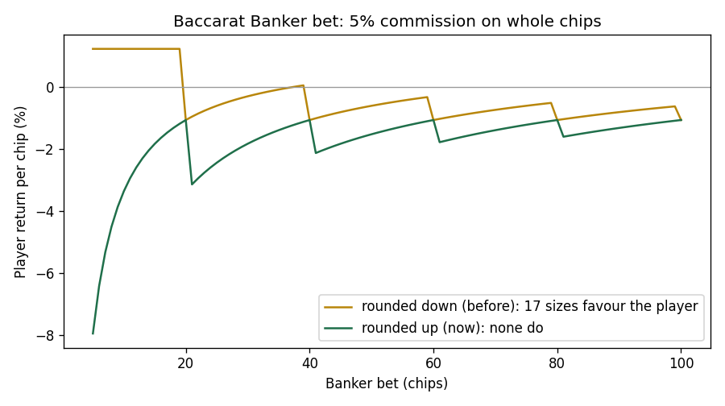
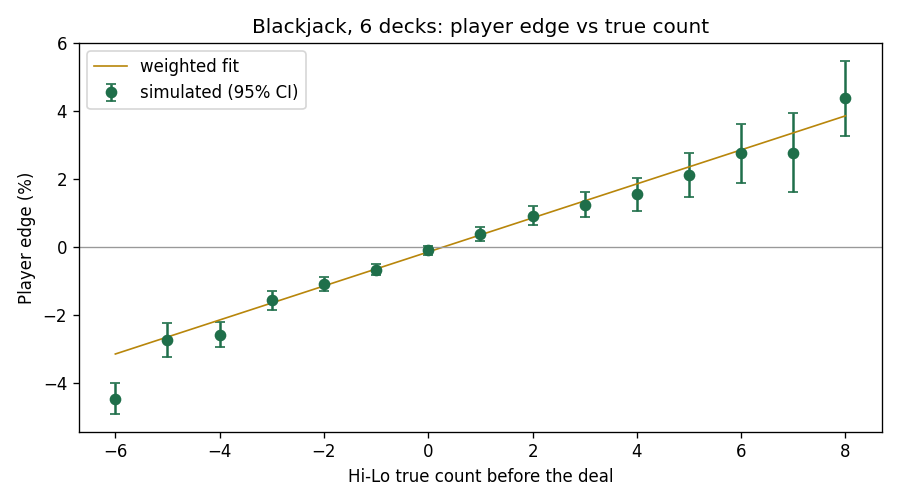
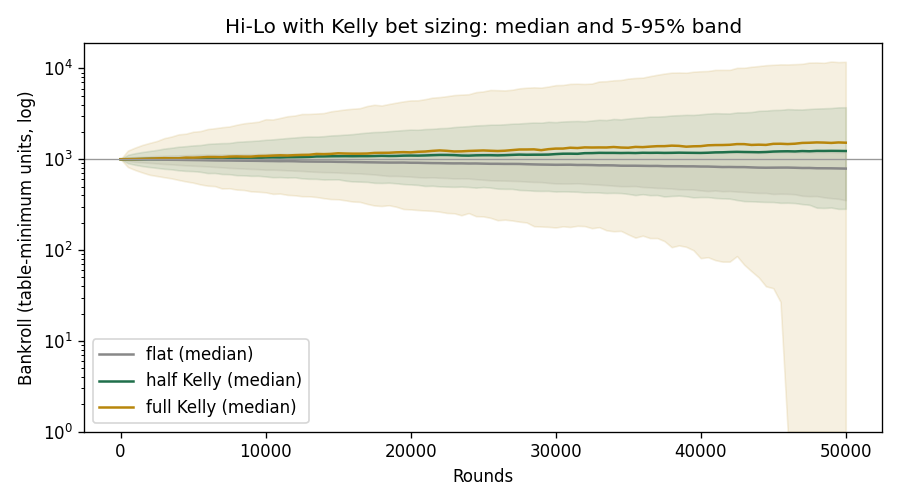
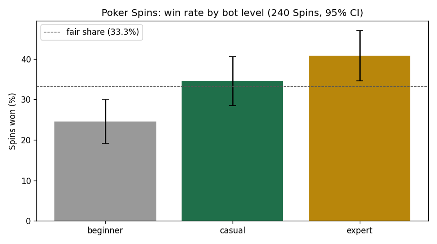

# Ace Royale Engine

The game engine behind **Ace Royale**, a free web card room for playing poker
with friends and practising casino games. This repository holds only the
computational core: rules, payouts, hand evaluation and the poker bots. The
web app that runs on top of it is a separate, private project.

Pure Python 3.9+, standard library only, no I/O: everything here just
computes, so it can be tested exhaustively and simulated in bulk. On top of it,
`sim/` holds the quant work: exact house edges, a blackjack basic strategy
derived by dynamic programming, Hi-Lo card counting with Kelly bet sizing over
10 million simulated rounds, and the economics of Poker Spins.

## What's inside

| Package | What it does |
|---|---|
| `aceroyale.blackjack` | Hand values (soft/hard), naturals, dealer rule (stands on 17), splits, doubles, insurance, settlement |
| `aceroyale.baccarat` | Punto banco with the full third-card tableau, 8-deck shoe, 5% banker commission, 8:1 tie |
| `aceroyale.three_card` | Three Card Poker ranking (straight beats flush), dealer qualifies with queen high, Ante, Play, Pair Plus and Ante bonus |
| `aceroyale.poker` | No-limit Texas Hold'em and Pot-Limit Omaha: hand evaluators, a single-hand engine with side pots, min-raise and short all-in rules, Monte Carlo bots for both games, and Spins (three-player sit & go with a random prize multiplier) |

Every game uses the same card encoding: an int `XYY`, where `X` is the suit
(1-4) and `YY` the rank (1 = ace ... 13 = king). `101` is an ace, `413` a king.

## Poker bots

Bots are a separate subsystem from the engine. The engine never asks a bot what
happens next: it hands the bot a read-only view of the table (its own hole
cards, the board, pot, stacks, legal actions) and the bot answers with an
*intent*, such as "raise to 40". The engine then validates that intent with the
same rules it applies to a human. A buggy bot can play badly, but it cannot
cheat or corrupt the hand.

Skill comes mostly from **how well each bot estimates its equity**, not from a
list of hand-written rules. Equity is estimated by Monte Carlo: deal random
hands to the opponents, complete the board, count how often the bot wins.
With few samples the estimate is noisy and the bot makes real mistakes, like a
beginner; with many it gets sharp. On top of that, each personality has its own
style: how loose it plays, how often it raises and bluffs. Decisions weigh that
equity against pot odds.

| Level | Display name | Monte Carlo samples |
|---|---|---|
| `beginner` | Rookie | 40 |
| `casual` | Casual | 120 |
| `advanced` | Sharp | 320 |
| `expert` | Shark | 650 |

The tests pit each level against the one below over hundreds of seeded hands
and check that the stronger level comes out ahead.

## Hand evaluator

`best_hand` is the reference implementation: it tries all 21 five-card
combinations of a 7-card hand. `score_7` is the fast path used by the bots,
which reads rank and suit counts directly. The two are checked against each
other on 30,000 random 5-, 6- and 7-card hands, and `evaluate_5` is checked
against the exact category frequencies of all 2,598,960 five-card hands.

| Evaluator (7 cards, Python 3.9) | Hands per second |
|---|---|
| `best_hand` (reference) | ~21,000 |
| `score_7` (fast path) | ~252,000 |

Measured on 20,000 seeded random hands; both give identical results.

## Pot-Limit Omaha

`OmahaHand` reuses the Hold'em engine (blinds, turns, side pots, the short
all-in rule) and changes only what makes Omaha a different game:

- **Four hole cards**, and the showdown hand uses **exactly two** of them plus
  three from the board. Four hearts on the board and one heart in hand is no
  flush; four aces on the board are worth only three. `best_omaha_hand` tries
  all 6 x 10 = 60 legal combinations and is checked against brute force.
- **Pot-limit betting**: the biggest raise is to call and then raise by the
  whole pot, i.e. `current bet + pot + amount to call`. With blinds 5/10 the
  first player in can raise to 35; with no bet yet, the most anyone can bet is
  the pot.

The same bots play it: `estimate_equity` reads the game from the number of hole
cards and deals four cards to each simulated opponent. AA-KK double-suited
comes out at about 0.69 equity heads-up, against roughly 0.85 for AA in
Hold'em, which is why Omaha is a game of closer equities. Each Omaha decision
costs about 110 ms against 5 ms in Hold'em, which is what the planned Rust
evaluator is for.

## Poker Spins

A three-player sit & go: each player buys in, starts with 500 chips, and the
blinds rise every 6 hands (10/20 up to 300/600) until one player has every
chip. Before the first hand a multiplier is drawn and the prize is
`buy-in x multiplier`:

| Multiplier | Probability | Prize split |
|---|---|---|
| x2 | 75% | winner takes all |
| x3 | 15% | winner takes all |
| x5 | 7% | winner takes all |
| x10 | 2.5% | winner takes all |
| x100 | 0.5% | 80% / 10% / 10% |

The table is configurable. These example odds give an expected multiplier of
3.05, so on average the three buy-ins (3x) pay back 3.05x: the format slightly
creates chips (return to players 101.7%). Measuring and tuning that is what
the planned Spins economy simulation is for.

`SpinTournament` only adds the tournament around the hands: it deals each
hand as a normal `Hand` (or `OmahaHand`), the caller drives it exactly like a
cash hand, and `record()` updates stacks, eliminations and blinds. Blinds rise
by hands rather than by time so the engine stays deterministic; a clock
belongs to whatever runs the game live. Players busted in the same hand are
ranked by the stack they started it with. `play_spin` runs a whole Spin
between three bots; with 25 big blinds to start, a bot Spin lasts about 10
hands on average.

```python
from aceroyale.poker import create_strategy, play_spin

bots = [create_strategy(level) for level in ("beginner", "casual", "expert")]
print(play_spin(bots, buy_in=100))
# {'multiplier': 2, 'prize_pool': 200, 'standings': ['P2', 'P0', 'P1'], ...}
```

## Quant results

Everything below is reproduced by `sim/` (about 3 minutes) and computed with the
engine's own rule functions, so it measures the games exactly as they are
played. `python -m sim.test_sim` checks the simulators against the engine.

### House edge

| Game and bet | Player return | How |
|---|---|---|
| Blackjack, basic strategy (6 decks, S17, DAS, 3:2) | **-0.42% ± 0.07%** | 10M simulated rounds, 95% CI |
| Blackjack, same strategy, infinite deck | -0.57% | exact, dynamic programming |
| Baccarat, Banker (multiples of 20) | **-1.06%** | exact enumeration of the 8-deck shoe |
| Baccarat, Player | -1.24% | exact |
| Baccarat, Tie (8:1) | -14.36% | exact |
| Three Card Poker, Ante/Play (optimal: play Q-6-4+) | **-3.37%** per Ante | exact, all 22,100 x 18,424 hand pairs |
| Three Card Poker, Pair Plus (1-4-6-30-40) | -2.32% | exact |

Two findings from checking the engine's rules rather than textbook ones:

- **Baccarat commission rounding was exploitable, and is now fixed.** The 5%
  commission used to be rounded down to whole chips, so a Banker bet of 5 to
  19 chips paid no commission at all and returned **+1.24%** to the player;
  17 bet sizes favoured the player in all. The engine now rounds up, and no
  bet size does. The price is paid by small odd bets (a 5-chip Banker bet
  gives up 1 chip of its 5-chip win: -7.94%), while multiples of 20 keep the
  exact -1.06%.
- **Pair Plus pays a flush 4:1.** That is the generous paytable (-2.32%); the
  common 3:1 version is -7.28%. And unlike most casinos, folding here also
  loses the Pair Plus bet, which never matters with optimal play (you never
  fold a pair or better).



### Blackjack basic strategy, derived

`sim/blackjack_strategy.py` computes the dealer's final-total distribution for
every upcard (given no dealer blackjack), then the value of standing, hitting
(a memoised recursion over hand states), doubling and splitting, and keeps the
best action in each cell. The result reproduces the published S17/DAS chart;
the one borderline cell, A,2 vs 5, comes out as hit by 0.7% of a bet in an
infinite deck, where 6-deck charts say double.

```
Hard     2   3   4   5   6   7   8   9   T   A     Soft     2   3   4   5   6   7   8   9   T   A
   9     H   D   D   D   D   H   H   H   H   H      A,2     H   H   H   H   D   H   H   H   H   H
  10     D   D   D   D   D   D   D   D   H   H      A,6     H   D   D   D   D   H   H   H   H   H
  11     D   D   D   D   D   D   D   D   D   H      A,7     S  Ds  Ds  Ds  Ds   S   S   H   H   H
  12     H   H   S   S   S   H   H   H   H   H     Pairs
  16     S   S   S   S   S   H   H   H   H   H      9,9     P   P   P   P   P   S   P   P   S   S
```

(Excerpt; the full table is printed by the script and stored in
`sim/results/blackjack_strategy.json`.)

### Hi-Lo card counting and Kelly bet sizing

10 million rounds in a 6-deck shoe cut at 75%, recording the Hi-Lo true count
before each deal. The player's edge rises by about **0.50% per true-count
point** and turns positive at a true count of about +0.3:



Kelly bets the fraction `edge / variance` of the bankroll when the count is
favourable (variance per round: 1.33) and the table minimum otherwise.
Bankroll of 1,000 minimum bets, table spread 1-100, 50,000 rounds, 2,000
bootstrapped paths with the same rounds for every strategy:

| Strategy | Median final bankroll | 5% / 95% | Risk of ruin | Paths that ever halved | Median max drawdown |
|---|---|---|---|---|---|
| Flat (always the minimum) | 788 | 354 / 1,195 | 0.1% | 24% | 37% |
| Half Kelly | **1,231** | 284 / 3,733 | 1.0% | 42% | 47% |
| Full Kelly | 1,520 | 0 / 11,825 | 6.2% | 91% | 71% |

Full Kelly grows fastest in the median but almost every path loses half the
bankroll along the way, and 6% go broke (bets are whole units and the counter
must keep playing negative counts). Half Kelly keeps most of the growth for a
fraction of the risk, which is why it is the practical choice. Caveat: the
edge per count is estimated from the same data and rounds are resampled
independently, so this is an idealised counter.



### Poker Spins economy

- The example multiplier table has an expected multiplier of **3.05** on 3
  buy-ins: return to players **101.7%**, so every Spin creates 1.7% of its
  buy-ins in new chips. 16% of all prize money comes from the 0.5% x100.
- A tuned table (x2 77%, x3 16%, x5 4.5%, x10 2.1%, x100 0.4%) returns 95.2%
  and turns Spins into a 4.8% chip sink.
- Luck dominates the short run: a player of average skill is in profit after
  50 Spins only 32% of the time, though the mean is positive.
- Skill still shows. In 240 Spins between bots, the expert won 40.8% (±6.2%),
  the casual 34.6% and the beginner 24.6%, against a fair share of 33.3%.



## Quick start

```bash
git clone <this repo>
cd ace-royale-engine
python3 tests/run.py          # or: pip install -e ".[dev]" && pytest

# simulations (need numpy and matplotlib)
python3 -m venv .venv && .venv/bin/pip install -r sim/requirements.txt
.venv/bin/python -m sim.test_sim
.venv/bin/python -m sim.run_all
```

A full Hold'em hand between two bots:

```python
from aceroyale.poker import Hand, Seat, create_strategy, view_for

seats = [Seat("A", 1000, is_bot=True), Seat("B", 1000, is_bot=True)]
bots = [create_strategy("expert", seed=1), create_strategy("beginner", seed=2)]
hand = Hand(seats, button=0, small_blind=5, big_blind=10)
while not hand.finished:
    i = hand.turn
    action, amount = bots[i].decide(view_for(hand, i))
    hand.act(i, action, amount)          # raises ValueError if illegal
print(hand.result["winners"], [s.chips for s in seats])
```

Pot-Limit Omaha is the same loop with `OmahaHand`:

```python
from aceroyale.poker import OmahaHand
hand = OmahaHand(seats, button=0, small_blind=5, big_blind=10)
```

A baccarat coup:

```python
from aceroyale.baccarat import Shoe, play_hand, settle

hand = play_hand(Shoe().draw)
print(hand["player"], hand["banker"], hand["winner"])
print(settle({"player": 0, "banker": 100, "tie": 0}, hand["winner"]))
```

## Tests

68 tests, about 50 seconds, all seeded so they are deterministic. Highlights:

- Exact enumeration of every five-card hand against the known category counts
- Fast evaluator vs. reference evaluator on random and hand-picked tricky hands
- Side pots, split pots (odd chip), short all-ins, chip conservation over hundreds of random hands
- Omaha: the exactly-two rule, pot-limit amounts, a rigged showdown that Hold'em rules would get wrong, bots playing legally
- Spins: multiplier frequencies over 200k draws, prize splits that always add up, rising blinds, double eliminations, full bot Spins
- The engine rejects every illegal action (wrong turn, under-minimum raise, over-stack bet...)
- Bots only ever see their own cards, cannot break the rules, and stronger levels beat weaker ones
- Blackjack splits, doubles, insurance and naturals; baccarat tableau; Three Card Poker payouts

## Roadmap

- Fast hand evaluator in Rust (bitmasks + lookup tables), benchmarked against `score_7`
- Multi-table tournaments (blind schedule, payout structure)
- Blackjack and baccarat side bets
- House edge of the side bets, and Hi-Lo playing deviations (insurance, Illustrious 18)

## Author

Built by **Bruno González**, with contributions from Pablo de la Fuente and
Robert Cincea.

## License

[MIT](LICENSE)
